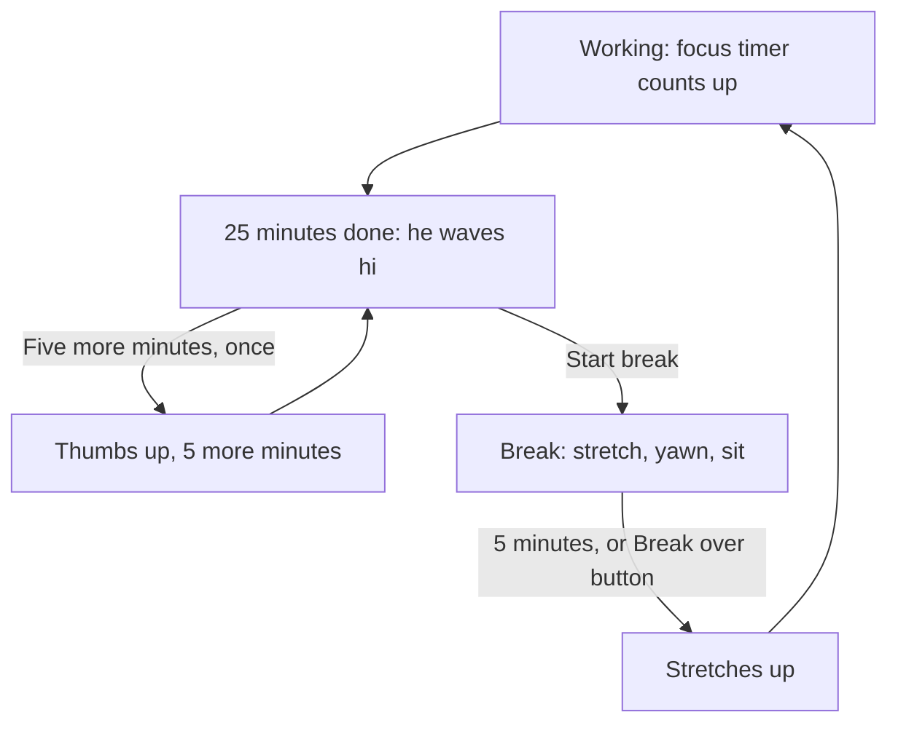

# Tokku: user flow (what triggers what)

Tokku lives in the top right corner of the desktop, behind your windows. There is no app window, page or panel around him. He only comes to the front when he has something to say, and small buttons appear only when you hover over him.

## Triggers and reactions

| What happens | Who notices | What Tokku does | Your choices |
|---|---|---|---|
| 25 minutes of active work | Brain (focus timer) | Comes forward, waves hi, bubble "Time for a 5 minute break" | Start break, Five more minutes (once) |
| Five more minutes chosen | You | Thumbs up, goes back, asks again after 5 minutes | Start break |
| Break started | You (bubble or hover button) | Stretches, yawns, sits relaxed; lies down after a minute | Break over (hover button) |
| Break over (5 minutes, or your button) | Brain or you | Stretches up, focus timer starts again | none |
| Meal (hover button or tray) | You | Falls asleep for 1 hour, no reminders, no phone ping | I'm back (hover button) |
| Meal over (1 hour, or your button) | Brain or you | Wakes up, stretches, "Shall we start?" | Resume focus |
| Video or game in front for 45 seconds | Guard (window title, discarded after classifying) | Comes forward onto that window, points at your top Notion task | 5 more minutes, Back to work |
| Notion task marked Done | Guard (Notion, read only) | Jumps, shows the check mark, proud pose, then the next task | none |
| Call, mic or camera in use, full screen work app, or Interview mode | Guard | Quiet mode: turns his back, dims, says nothing. Timers keep running | none |
| Quiet mode ends | Guard | Turns back, gives the one thing he held back | as for that reminder |
| Idle or locked for 30 minutes (not during a meal or Quiet mode) | Guard | One phone ping. When you return: happy welcome back | none |
| You hover over him | Renderer | Shows 2 small buttons that fit the moment | see below |
| You drag him away | Renderer | Hangs, lands, walks back to his corner. Annoyed from the second time | none |

## Distraction flow (video or game in front)

| Step | What you see | Buttons |
|---|---|---|
| 45 seconds on YouTube, Netflix, Hotstar, Prime Video, Steam or Epic Games | Comes forward, points, names the app and your task | 5 more minutes, Back to work |
| 5 more minutes | Open palm (five), then he looks away while you watch | none |
| The 5 minutes are over and it is still in front | Checks his watch: "Please turn it off" | Back to work |
| Back to work | Thumbs up. You get one minute to really close it | none |
| Third nudge within 30 minutes | Angry pose, firmest line | Back to work |
| You close the video yourself at any point | Bubble goes away, thumbs up, "Good choice" | none |
| You ignore his question for a minute | He sighs and asks again in 2 minutes | as before |
| After 11:30 pm | Late night lines instead of the gentle ones | as before |

No nudge during a meal, in Quiet mode, or while you are away from the keyboard.

## Hover buttons

| When | Buttons |
|---|---|
| Working | Take a break, and Breakfast, Lunch or Dinner (chosen by the time of day) |
| On a break | Break over |
| Meal (asleep) | I'm back. Clicking him also wakes him |

## Focus and break loop

## Who is allowed to do what

- **Tokku (the character window):** draws, talks, shows buttons. No internet, no camera, no microphone, no access to files.
- **Guard (the background part):** reads the front window title and classifies it, reads idle time and lock state, reads Notion (read only), sends the fixed phone message. Nothing else.
- **Tokku never** closes, blocks, minimises or types into anything.
